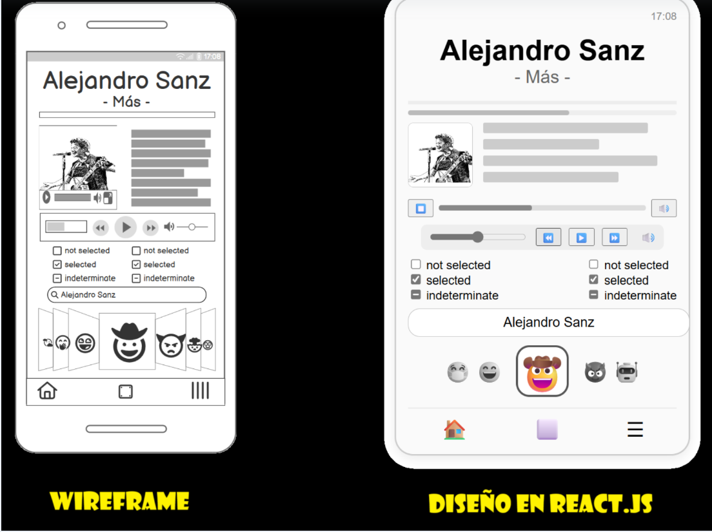
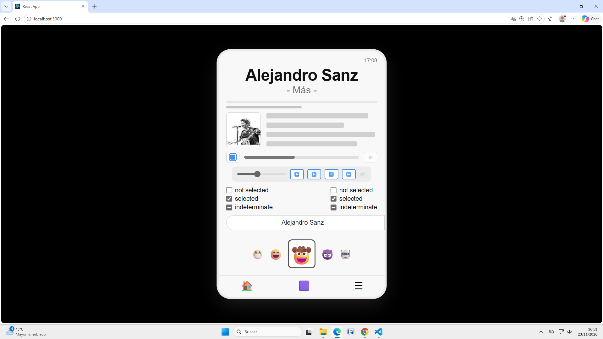

# Reproductor de música – Alejandro Sanz (React)

Aplicación hecha con **React** que reproduce visualmente el mockup de un reproductor musical con el disco *Más* de Alejandro Sanz. El objetivo de la práctica es transformar un diseño estático en una interfaz real, dividida en componentes, y dejarla preparada para cambiar de cantante (por ejemplo, David Bisbal) tocando un solo archivo.

> No se ha implementado la funcionalidad real de reproducción: solo la interfaz.

## Diseño de partida y resultado

| Diseño de Referencia entregado | Resultado en React |
|---|---|
|  |  |

## Cómo ejecutarlo

```bash
npm install
npm start
```

La aplicación se abre en <http://localhost:3000>.

## Proceso de creación

1. **Análisis del mockup.** Identifiqué los bloques visuales de arriba abajo: encabezado, barras de progreso, foto con texto simulado, controles, casillas, búsqueda, carrusel de emojis y navegación inferior.
2. **Creación del proyecto.** Lo generé con Create React App y limpié la plantilla (`logo.svg`, texto de ejemplo de `App.js`).
3. **Un componente por archivo.** Cada bloque se escribió como un componente funcional independiente en `src/components/`, con su propio archivo `.jsx`. Los nombres de las funciones empiezan en mayúscula, porque React lo exige para distinguir componentes de etiquetas HTML.
4. **Componente principal.** `App.js` importa todos los componentes y los junta en el mismo orden que el mockup.
5. **Estilos.** Todo el aspecto visual (tarjeta con forma de móvil, colores, bordes azules de los controles, emoji central destacado…) está en `src/App.css`.
6. **Estado mínimo.** Aunque no se pedía funcionalidad, usé `useState` en el volumen, en los botones play/pausa y en el carrusel, y `useRef` + `useEffect` para la casilla indeterminada, que solo se puede activar por código.
7. **Datos separados.** Para poder cambiar de cantante, el artista, el álbum y la imagen se sacaron a `src/Datos.js` y se pasan a los componentes como *props*.

## Componentes

| Elemento del enunciado | Componente |
|---|---|
| Encabezado con artista y álbum en dos líneas | `encabezado.jsx` |
| Barras de progreso superiores | `barraProgreso.jsx` |
| Imagen del cantante con bloques de texto simulado | `seccionLateral.jsx` |
| Play, pausa, avance, progreso y volumen | `controles.jsx` |
| Casillas desmarcada, marcada e indeterminada | `muestraCasillas.jsx` |
| Barra de búsqueda | `barraBusqueda.jsx` |
| Carrusel de emojis con el central destacado | `emojis.jsx` |
| Barra de navegación inferior con tres iconos | `barraNavegacion.jsx` |

Hay 8 componentes más `App`, por encima del mínimo de 6 que pide el enunciado.

## Estructura del proyecto

```
conversion_react/
├── docs/
│   ├── mockup.png          # diseño de partida
│   └── resultado.png       # captura del resultado
├── public/
│   └── alejandro.png       # imagen del cantante
└── src/
    ├── App.js              # junta todos los componentes
    ├── App.css             # estilos
    ├── Datos.js            # artista, álbum e imagen
    └── components/
        ├── encabezado.jsx
        ├── barraProgreso.jsx
        ├── seccionLateral.jsx
        ├── controles.jsx
        ├── muestraCasillas.jsx
        ├── barraBusqueda.jsx
        ├── emojis.jsx
        └── barraNavegacion.jsx
```

## Cómo cambiar de cantante (por ejemplo, Bisbal)

Los componentes no tienen ningún dato escrito a mano: reciben el título, el subtítulo y la imagen por *props*. Por eso, para cambiar de cantante solo hay que tocar `src/Datos.js`:

1. Copia la foto del nuevo cantante en la carpeta `public/` (por ejemplo `public/bisbal.png`).
2. En `src/Datos.js` ya hay un cantante preparado (`bisbal`) con su nombre, álbum e imagen. Puedes editar sus datos si quieres otro álbum.
3. Cambia la última línea del archivo:

```js
export const cantanteActual = cantantes.bisbal;
```

Se actualizan solos:
- el **título** (artista) y el **subtítulo** (álbum) del encabezado,
- la **imagen** del cantante y su texto alternativo,
- el texto de la **barra de búsqueda**.

Para añadir otro cantante, basta con copiar uno de los bloques de `cantantes` en `src/Datos.js`.

## Tecnologías

- React (Create React App)
- JavaScript (JSX) y CSS
- Git y GitHub